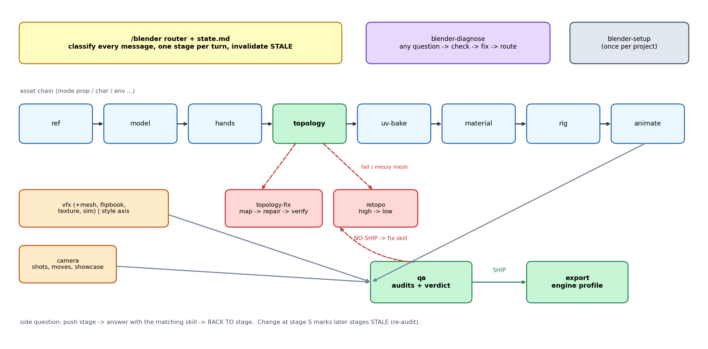

# Build guide (cards: what to build, in what order, what good looks like)

Contents: 1 how to read | 2 prop | 3 character | 4 hands | 5 fix a mesh | 6 VFX | 7 camera

## 1. How to read
Each card is the plan the router prints (5 lines) and the checks behind it. "Good looks like" = what the audit and screenshots must show. Rigor (config.md) decides how many stages run per turn; skip rules are in routes.md section 5.

## 2. Prop (static, game-ready)
| Step | Do | Good looks like |
|---|---|---|
| 1 ref (optional) | analyze image, measure bbox/palette | ref-analysis.md, hidden sides labeled [ASSUMED] |
| 2 model | blockout from primitives at real size | front/side silhouette matches; transforms applied |
| 3 topology | budget -> silhouette -> remove hidden -> bake -> measure | tris at or under budget, ngons 0 |
| 4 uv-bake | seams on hard edges, density in tolerance (or palette UVs) | audit_uv pass, no seams visible in bake |
| 5 material | Principled + image nodes only | names MAT_/T_, correct color spaces |
| 6 qa -> export | fresh audits, verdict, engine export | SHIP; file exists |
Common mistakes: subdivision for roundness, bevels as geometry (use normal map), interior faces, unapplied scale.

## 3. Character (rig-ready)
Order: ref -> model(A-pose, symmetric) -> hands -> topology (joint loops, poles away from joints) -> uv-bake -> material -> rig -> animate -> qa -> export.
Pictures: `figures/rig-ready-zones.png`, `figures/joint-loops.png`.
| Gate | Number |
|---|---|
| joint loops | per deformation-zones.md tier |
| poles/tris/ngons near joints | 0 |
| symmetry unmatched | 0 |
| influences per vertex | engine limit (default 4 [START]) |
Common mistakes: single loop at the shoulder, pole at the elbow, skinning in a different pose.

## 4. Hands
Order: tier from style -> compute tris first -> wrist ring count = forearm -> palm openings -> finger tubes with joint loops -> thumb base loops -> rest pose -> weight plan.
Pictures: `figures/finger-tiers.png`, `figures/hand-layout.png`.
| Tier | Hand tris (finger tubes + palm and wrist) |
|---|---|
| Ultra | 142-162 |
| Low | 356-396 |
| Mid | 772-872 |
| Hero | 1,146-1,346 |
Common mistakes: fingers touching in the rest pose, different ring counts per finger, triangles at knuckles.

## 5. Fix a mesh
checkpoint -> audit_mesh + audit_topology (defect map) -> recipes A (cleanup) -> B (face types) -> C (flow) -> escalate if the defect rate is 5-15 percent (local patch) or above 15 percent (retopo) -> verify -> report before/after.
Loop density changes use `figures/transition-patterns.png` blocks (parity rule: N + M + left + right even).

## 6. VFX
Order: style (`fx=`) -> recipe from the cookbook -> cheapest type -> layers with t-ranges -> assets -> style audit -> readability on dark and light -> qa -> export.
Pictures: `figures/vfx-style-compare.png`, `figures/vfx-life-curve.png`.
| Gate | Number |
|---|---|
| peak position | 0.15-0.45 of the life |
| last frame energy | at most 10 percent of the peak |
| low-poly | soft alpha <= 0.15, colors <= 8, 4-12 frames |
| layers | pc 4-6, mobile 2-3 |

## 7. Camera
Order: shot list (purpose per shot) -> move from purpose -> size/angle/lens -> rig -> timing and easing -> sequence markers -> audit -> screenshots -> deliver.
Picture: `figures/camera-moves.png`.
| Gate | Number |
|---|---|
| horizon | roll within 1 degree (except roll shots) |
| subject | framed at start, middle, end |
| clip planes | clip_start below nearest distance, clip_end above farthest |
