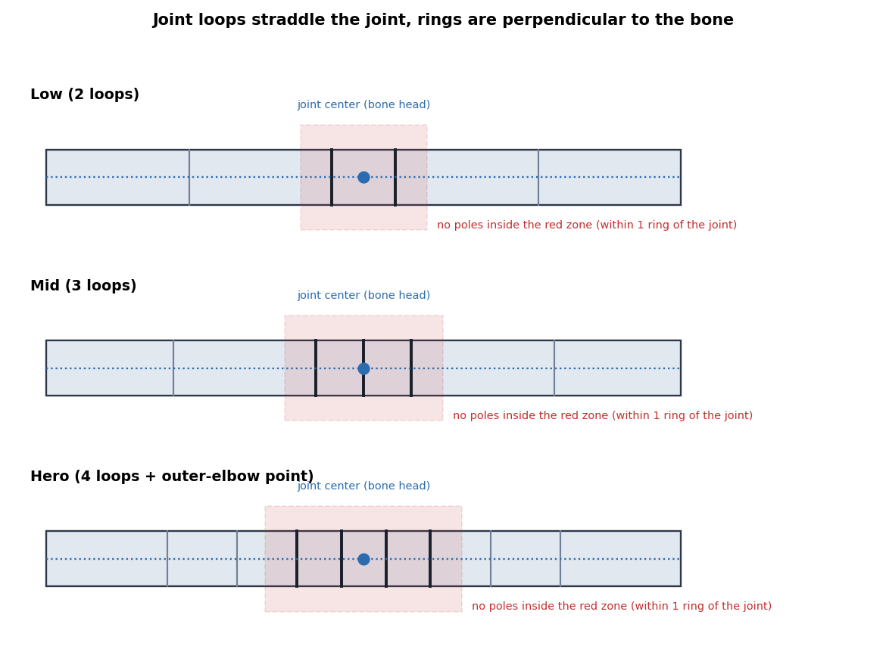
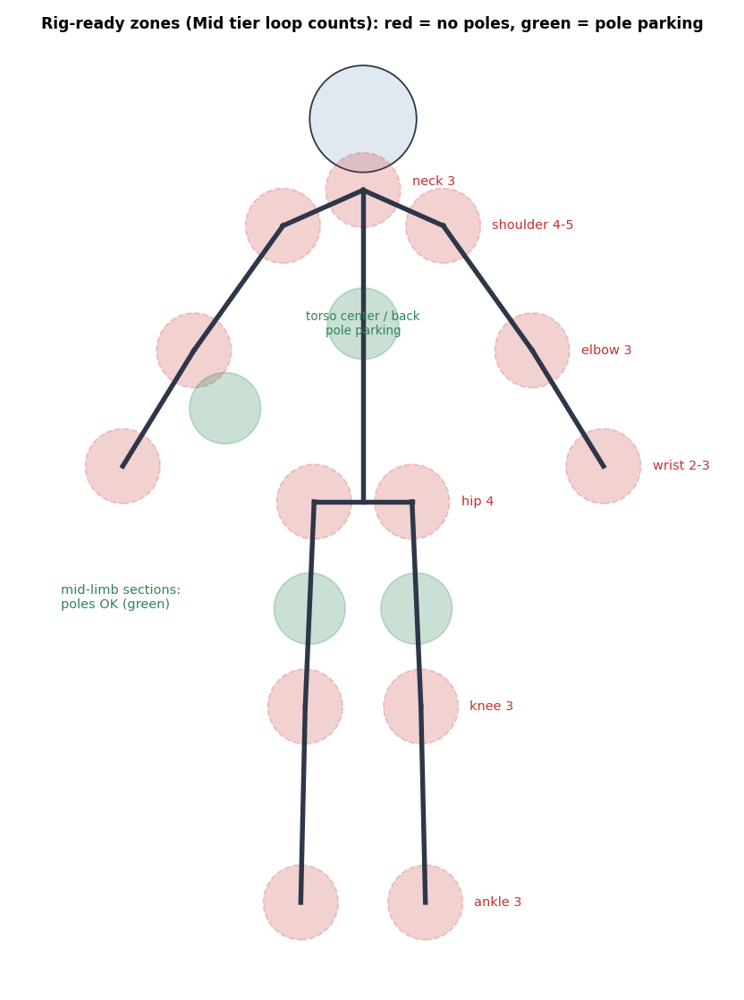

# Deformation zones (loops, rings, poles) - rig-ready topology

Contents: 1 universal rules | 2 zone table | 3 ring vertex counts | 4 rest pose | 5 checks

Tiers: Low = lowpoly, voxel soft joints, mobile | Mid = stylized, NPC | Hero = realistic, close-up.
"Joint loops" = edge loops perpendicular to the bone axis within half a bone segment of the joint center. Numbers are [START] best-practice values; the audit gate counts poles/ngons/tris, you judge loops from the wireframe screenshot.

## 1. Universal rules
| Rule | Detail |
|---|---|
| Rings perpendicular to the bone | joint loops run around the limb, not along it |
| Loop placement | 2 loops straddle the joint center at about 10 percent of the segment length each side; 3 loops = one at center + two flanking; 4-5 loops add the outer-elbow/knee point |
| Constant ring vertex count | the same number of vertices per ring along a limb |
| Transition position | density changes (transition-patterns.md) in the middle of a segment, never within 1 ring of a joint |
| Poles | never within 1 ring of a joint; park them on flat or low-motion areas |
| Quad gradient | smaller quads at the joint, larger mid-segment |
| Follow muscles | on outer limb areas let loops follow the muscle direction (deltoid, bicep, calf) when Hero |

## 2. Zone table
| Zone | Low | Mid | Hero | Loop direction and flow | Pole rule | Common error |
|---|---|---|---|---|---|---|
| Shoulder / armpit | 3 rings around the arm root | 4-5 | 6+ | rings around the arm root, chest and back lines wrap into them | pole at back of shoulder or armpit side, not on top of the shoulder | single loop: shoulder collapses when arm raises |
| Upper arm | 1-2 mid rings | 2 | 3 | rings perpendicular to the arm | none needed | uneven ring count |
| Elbow | 2 | 3 | 4-5 | rings straddle the elbow; extra loop at the outer point | none within 1 ring | flat spot, volume loss when bent |
| Forearm | 2 | 3 | 4 + twist support (rig variants) | rings along the forearm; wrist ring count matches the hand | none | candy-wrapper twist |
| Wrist | 2 | 2-3 | 3 | ring vertex count equals the hand wrist ring | none | mismatched vertex counts forearm vs hand |
| Fingers | see blender-hands | | | | | |
| Spine / torso | ring every spine segment (2-3 total) | 4 | 6+ | rings around the torso; front and back center lines | pole near the sternum or lower back is fine | no waist ring |
| Hip / pelvis | 3 rings radiating around the hip joint | 4 | 6 | loops circle the hip joint; groin and glute lines meet in poles away from the crease | pole at the outer hip or glute, not at the hip crease | quads cross the crease |
| Upper leg | 1-2 | 2 | 3 | rings perpendicular to the thigh | none | none |
| Knee | 2 | 3 | 4-5 (+ kneecap loop) | rings straddle the knee; extra loop above the kneecap | none within 1 ring | kneecap flat |
| Ankle | 2 | 3 | 3-4 | rings around the ankle; ring count matches the foot top | none | collapsed ankle |
| Foot ball / toes | 1-2 loops at the ball (toe bend) | 2 | 3 | ring across the foot at the ball | none | toes fused |
| Neck | 2 rings | 3 | 4 | rings around the neck; ring count matches head base and shoulders | none | no ring at base of the skull |
| Jaw / mouth | 1 ring around the mouth | 2-3 | 4+ | concentric rings around the lips; jaw hinge region quads only | 5-poles at the outer mouth corners only | triangles at mouth corners |
| Eyes | 0-1 (eyes textured) | 2 | 3-4 concentric rings | concentric rings around the eyelids | 5-poles at the outer eye corners | one ring: eyelids will not blink |
| Tail / tentacle | ring every half bone length | same | same | constant ring vertex count | none | changing ring counts |

## 3. Ring vertex counts
| Part | Low | Mid | Hero |
|---|---|---|---|
| Fingers | 4-6 | 6-8 | 8 |
| Wrist, forearm | 6-8 | 8 | 8-12 |
| Upper arm, leg | 6-8 | 8 | 8-12 |
| Torso | 8-12 | 12 | 12-16 |
| Neck | 6-8 | 8 | 8-12 |
Match counts at every junction (wrist, neck, ankle). A mismatch needs a transition pattern located mid-segment.

## 4. Rest pose
| Item | Rule |
|---|---|
| Arms | A-pose 40-45 degrees down (reduces shoulder deformation) unless engine.md requires T-pose |
| Elbows / knees | 5-10 degrees bent to define bend direction for IK |
| Fingers | relaxed, slightly curled 10-25 degrees, spread with visible gaps |
| Mouth / eyes | closed, relaxed |

## 5. Checks
`audit_topology.py` with ARMATURE set: poles_near_joints = [], tris_near_joints = [], ngons_near_joints = []. Wireframe screenshots of every joint from the bend side. Pose test later in blender-rig.
