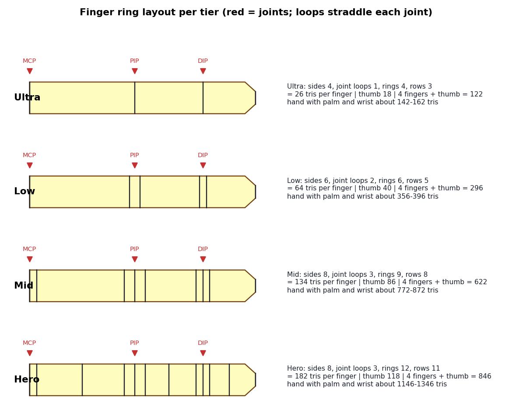
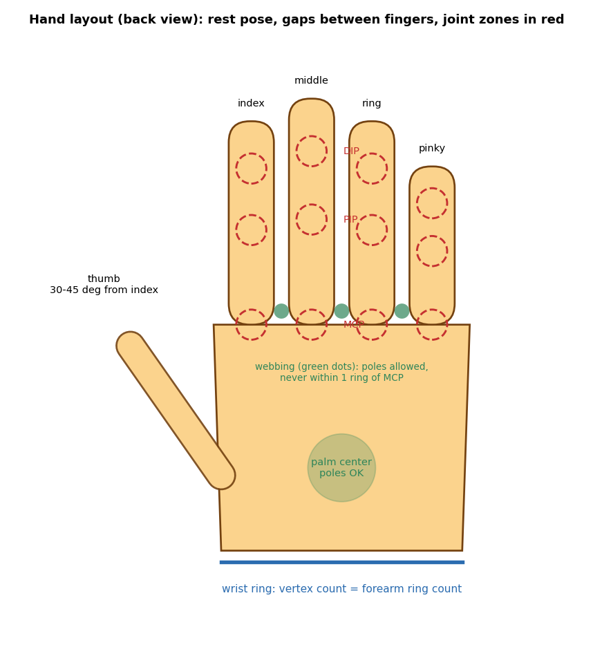

# Hand topology (numbers, construction, errors)

Contents: 1 tier table | 2 triangle formulas | 3 palm and openings | 4 joint loops | 5 tips | 6 thumb | 7 rest pose | 8 bones and weights | 9 common errors

Values marked [COMPUTED] come from the formulas in section 2. Values marked [START] are starting points, not engine limits.

## 1. Tier table (per finger tube)
| Tier | Sides | Loops per joint (PIP, DIP) L | Loops at finger side of MCP | Extra mid-phalanx rings | Rings | Rows |
|---|---|---|---|---|---|---|
| Ultra (mobile, soft-voxel) | 4 | 1 | 1 | 0 | 4 | 3 |
| Low (lowpoly) | 6 | 2 | 1 | 0 | 6 | 5 |
| Mid (stylized) | 8 | 3 | 2 | 0 | 9 | 8 |
| Hero (realistic) | 8 | 3 | 2 | 3 | 12 | 11 |
Rings = L_mcp + L + L + 1 + extra. Rows = rings - 1.

## 2. Triangle formulas and results [COMPUTED]
| Item | Formula |
|---|---|
| Finger tube | 2 x sides x rows |
| Flat tip cap | sides - 2 |
| Finger total | tube + cap |
| Thumb rings | L_mcp + L + 1 + extra_thumb (extra_thumb: Ultra 0, Low 0, Mid 0, Hero 2) |
| Thumb rows | thumb rings - 1 |
| Fingers sum (4 fingers + thumb) | 4 x finger + thumb |
| Hand total | fingers sum + palm and wrist |

| Tier | Finger | Thumb | Fingers sum | Palm + wrist [START] | Hand total approx |
|---|---|---|---|---|---|
| Ultra | 26 | 18 | 122 | 20-40 | 142-162 |
| Low | 64 | 40 | 296 | 60-100 | 356-396 |
| Mid | 134 | 86 | 622 | 150-250 | 772-872 |
| Hero | 182 | 118 | 846 | 300-500 | 1,146-1,346 |
Cartoon 4-finger (3 fingers + thumb): subtract one finger from the sum. Blocky and mitten variants have their own counts in the variant files. Check the result against the hand budget before modeling.

## 3. Palm and openings
1. Wrist ring first: vertex count W = forearm ring count at the wrist.
2. Palm block: a box-like form with back (dorsal) and front (palmar) faces, width for 4 fingers + thumb side.
3. Cut one opening per finger on the palm's finger edge, each with `sides` vertices; the thumb opening sits on the side of the palm, angled 30-45 degrees [START] from the index.
4. Bridge each finger tube base ring to its opening (`bmesh.ops.bridge_loops` or edge-loop bridge, same vertex count both sides).
5. Between fingers (webbing): quads only; poles allowed here (low motion) but not within 1 ring of the MCP joint zone.
6. Palm center: poles allowed.
7. Transition from palm to wrist ring W: use a transition pattern from docs/blender/reference/transition-patterns.md, placed in the middle of the palm.

## 4. Joint loops
| Joint | Where | Loops |
|---|---|---|
| MCP (finger base) | straddles the finger/palm junction: L_mcp loops on the finger side, palm side already quads | per tier |
| PIP (middle joint) | at the crease on the palm side and knuckle on the back, rings perpendicular to the finger | L |
| DIP (tip joint) | same as PIP | L |
Loops straddle the joint center at about 10 percent of the phalanx length each side [START]. Phalanx length ratios proximal : middle : distal about 1 : 0.65 : 0.5 [START]; replace with the reference when available. Finger length vs middle finger = 1.0: index 0.9, ring 0.9, pinky 0.7, thumb visible part 0.7 [START].

## 5. Tips
| Tier | Tip |
|---|---|
| Ultra, Low | flat cap (sides - 2 tris) or a single center vertex fan (sides tris) |
| Mid, Hero | fan to a pole at the tip; add the nail only as texture (Mid) or a 4-8 tri plate (Hero) |

## 6. Thumb
Thumb has 2 visible phalanges and its base joint (CMC) sits in the palm: add L_mcp + 1 loops around the thumb base across the thenar area so the thumb can rotate and oppose. Thumb ring vertex count = finger `sides`.

## 7. Rest pose
| Item | Rule |
|---|---|
| Fingers | relaxed, curled 10-25 degrees [START] |
| Spread | visible gap between fingers (at least half a finger width [START]) |
| Thumb | 30-45 degrees away from the index [START] |
| Wrist | straight, same axis as the forearm |

## 8. Bones and weights
| Rig tier | Bones per hand | Layout |
|---|---|---|
| Full | 16 | hand + 3 per finger x 5 [COMPUTED] |
| Full + metacarpals | 20 | adds 4 palm bones [COMPUTED] |
| Reduced | 11 | hand + 2 per finger x 5 [COMPUTED] |
| Mitten | 2 | hand + thumb |
| Blocky | 1 | hand only |

Weight ramp across a joint with L loops: loop i (1..L) weights = (1 - i/(L+1)) to the parent bone and i/(L+1) to the child bone. L = 1: 0.5/0.5. L = 2: 0.67/0.33 and 0.33/0.67. L = 3: 0.75/0.25, 0.5/0.5, 0.25/0.75.
| Region | Weights |
|---|---|
| Palm | 1.0 hand bone |
| Finger mid-phalanx | 1.0 that phalanx bone |
| Webbing between fingers | about 0.7 hand bone, 0.15 each neighbor finger [START] |
| Each finger | only its own chain and the hand bone; never a neighboring finger except in the web |
Max influences per vertex from engine.md; default plan stays at 2 for fingers.

## 9. Common errors
| Error | Cause | Fix |
|---|---|---|
| Finger cross-section collapses on curl | too few loops or sides | raise tier or sides; add loop |
| Wrist twists badly | ring mismatch or no wrist loops | match ring counts; 2-3 wrist loops |
| Knuckle flat | no loops at MCP | add L_mcp loops |
| Fingers weights bleed | weights painted across fingers | per-finger weight isolation (section 8) |
| Thumb cannot oppose | no thenar loops | add thumb base loops |
| Left/right differ | rebuilt separately | mirror the right hand |
| Triangles near joints | auto-fill | topology-fix recipe B |
