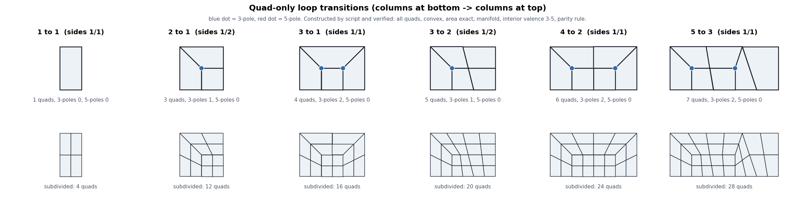

# Loop transition patterns (change quad density with quads only)

Contents: 1 definition and parity rule | 2 verified catalog | 3 block grammar | 4 choosing and composing | 5 how to apply | 6 verify | 7 figures

## 1. Definition and parity rule
A strip has N quad columns at the bottom and M at the top; a transition pattern converts N to M using only quads. The patterns below were CONSTRUCTED by `tools/make_figures.py` and VERIFIED by script (all faces quads and convex, areas add up exactly, every edge shared by at most 2 faces, Euler characteristic 1, interior valence only 3-5, boundary on the border).
Parity rule (a mathematical fact for all-quad patches): the number of boundary edges must be even. For a rectangular patch: N + M + (edges on the left side) + (edges on the right side) must be even. When it is odd (for example 2 to 1 with one edge per side) no all-quad pattern exists: put an extra vertex on one side (that side then has 2 edges: a T-junction) or add a neighboring strip. This is why 2 to 1 and 3 to 2 appear with sides 1 / 2.

## 2. Verified catalog (from figures/verified-patterns.json)
| Pattern | Outer sides (left / right edges) | Quads | 3-poles | 5-poles | Drawn |
|---|---|---|---|---|---|
| 1 to 1 | 1 / 1 | 1 | 0 | 0 | yes |
| 2 to 1 | 1 / 2 | 3 | 1 | 0 | yes |
| 3 to 1 | 1 / 1 | 4 | 2 | 0 | yes |
| 3 to 2 | 1 / 2 | 5 | 1 | 0 | yes |
| 4 to 2 | 1 / 1 | 6 | 2 | 0 | yes |
| 5 to 3 | 1 / 1 | 7 | 2 | 0 | yes |
| 6 to 3 | 1 / 2 | 9 | 3 | 0 | verified, not drawn |
| 6 to 2 | 1 / 1 | 8 | 4 | 0 | verified, not drawn |
Every pattern keeps interior valences in {3, 4, 5}. Each reduction block costs one 3-pole per two columns merged (3 to 1 costs two).
Expansion (1 to 3, 2 to 4, 3 to 5) is the same pattern flipped upside down.

## 3. Block grammar (how the patterns are built)
Blocks sit side by side; the vertical lines between blocks have either 1 edge or 2 edges (2 = one extra vertex in the middle).
| Block | Columns in -> out | Side edges (left, right) | Interior poles |
|---|---|---|---|
| S (straight) | 1 -> 1 | (1, 1) or (2, 2) | none |
| A (pair) | 2 -> 1 | (1, 2) or (2, 1) | one 3-pole |
| C (triple) | 3 -> 1 | (1, 1) | two 3-poles |
Composition: the right side of one block equals the left side of the next. Examples: 4 to 2 = A(1,2) + A(2,1). 5 to 3 = A(1,2) + A(2,1) + S(1,1). 3 to 2 = A(1,2) + S(2,2). 6 to 3 = A(1,2) + A(2,1) + A(1,2). 6 to 2 = C + C.

## 4. Choosing and composing
1. Count N (dense end) and M (sparse end) on the wireframe screenshot.
2. Split N into M groups of size 1, 2 or 3 (S, A, C); each group of size k reduces k columns to 1.
3. Chain the side values left to right; if a block needs sides the previous block did not give, change the previous block's side to 2 (add a middle vertex) or pick a different split.
4. Check parity: N + M + left + right is even.
5. Larger ratios: apply a pattern, leave at least one full quad ring, apply the next.

## 5. How to apply
1. Place it where nothing bends: not within 1 ring of a joint (deformation-zones.md), not on a silhouette curve of a static prop, not over a seam.
2. Work from a checkpoint, one pattern at a time, with loop cuts, edge slide, connect and dissolve.
3. Keep the boundary vertices of the strip unchanged.

## 6. Verify
| Check | Expected |
|---|---|
| ngons | 0 |
| tri faces | unchanged |
| new poles | exactly the 3-poles listed for the pattern, all outside joint zones (audit_topology) |
| thin_quads | 0 |
| pole_balance (closed all-quad meshes) | still a multiple of 8 |
| screenshot | flow lines continue on both sides |
If any check fails: restore the checkpoint; try another location, split or side choice.

## 7. Figures
Original diagrams are generated by `tools/make_figures.py` from the kit's own data; no third-party images are shipped. You may add your own reference images next to them in `figures/` (see figures/README.md).
