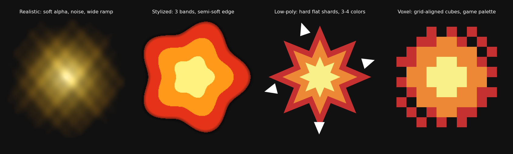
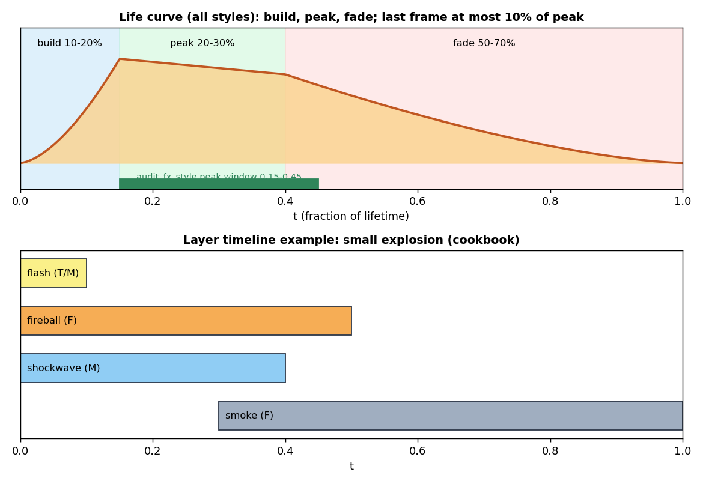

# VFX styles (realistic, stylized, low-poly game-like, voxel)

Contents: 1 style table | 2 build checklist per style | 3 audit presets | 4 common errors

fx_style = the `fx=` argument, else config.md `fx_style`, else config.md `style`. All numbers are [START] values, not engine limits. The same life curve applies to every style: build 10-20 percent, peak 20-30, fade 50-70 of the lifetime.

## 1. Style table
| Dimension | Realistic | Stylized | Low-poly game-like | Voxel |
|---|---|---|---|---|
| Shape language | organic, irregular, turbulent | simplified readable shapes, some curl | faceted shards, flat discs, rings, stars, chunky silhouettes | cubes, square particles, pixel bursts |
| Alpha edges | soft gradients, translucency | semi-soft, cartoon edge | hard cutout (alpha almost 0 or 1) | hard, pixel-aligned |
| Color | wide ramps (for example dark red to orange to yellow to white), subtle variation | 3-5 saturated colors | 2-4 flat colors + 1 highlight | 2-4 colors from the game palette |
| Frame texture size | 256-512 | 128-256 | 64-128 | 16-64 with nearest filtering |
| Flipbook frames | 16-64 (smooth) | 8-24 | 4-12, stepped (hold frames, feels like 8-12 fps) | 4-8, stepped |
| FX mesh triangles | 100-500 | 30-150 | 8-60 (shards 4-12 each) | 12-120 (boxes) |
| Motion | smooth easing, secondary motion, motion blur | snappy ease with small overshoot | stepped or snappy, scale pop with 10-20 percent overshoot, holds | stepped, positions snapped to the voxel grid |
| Glow | subtle, physically plausible bloom | strong additive glow | flat emissive color, no gradient | flat bright color |
| Noise | multi-octave | 1-2 octaves | none: use shape variation | none |
| Typical lifetime (impact) | 0.3-0.8 s | 0.2-0.6 s | 0.15-0.5 s | 0.15-0.4 s |
| Smoke/dust | volumetric look, lit | puffy cartoon clouds | stacked low-poly spheres or flat cutout puffs | cube puffs |

## 2. Build checklist per style
| Style | Do | Do not |
|---|---|---|
| Realistic | simulate or layer noise textures; render with motion blur; grayscale + alpha for tintable smoke; neutral lighting; larger frames | bake colored lighting that conflicts with the scene; huge sheets without need |
| Stylized | design 3-5 color ramp; strong silhouette first; ease with overshoot | photoreal noise; muddy gradients |
| Low-poly game-like | draw with geometry first; render flat/emissive; hard alpha; stepped timing; max 8 quantized colors | soft gradients, blur, many frames, fine noise |
| Voxel | build from cubes on the game grid; palette colors only; nearest filtering | non-grid rotations, smooth motion blur |

## 3. Audit presets (audit_fx_style.py PRESETS)
| Style | Max soft-alpha ratio | Max quantized colors (3 bits per channel) | Frame range |
|---|---|---|---|
| realistic | none | none | 16-64 |
| stylized | 0.50 | 24 | 8-24 |
| lowpoly | 0.15 | 8 | 4-12 |
| voxel | 0.05 | 6 | 4-8 |
Peak position 0.15-0.45 of the life and last-frame energy at most 10 percent of the peak apply to every one-shot flipbook.

## 4. Common errors
| Error | Style | Fix |
|---|---|---|
| Effect looks muddy | stylized, lowpoly | cut colors, raise contrast, use hard edges |
| Effect looks cheap and noisy | realistic | add layering (flash, core, secondary, smoke), use motion blur, more frames |
| Looks inconsistent with the game | all | take colors from the palette in style.md and the game's key art |
| Pops off at the end | all | fade tail: last frame energy under 10 percent of peak |
| Too many layers | all | cap by platform: pc 4-6 layers, mobile 2-3 |
